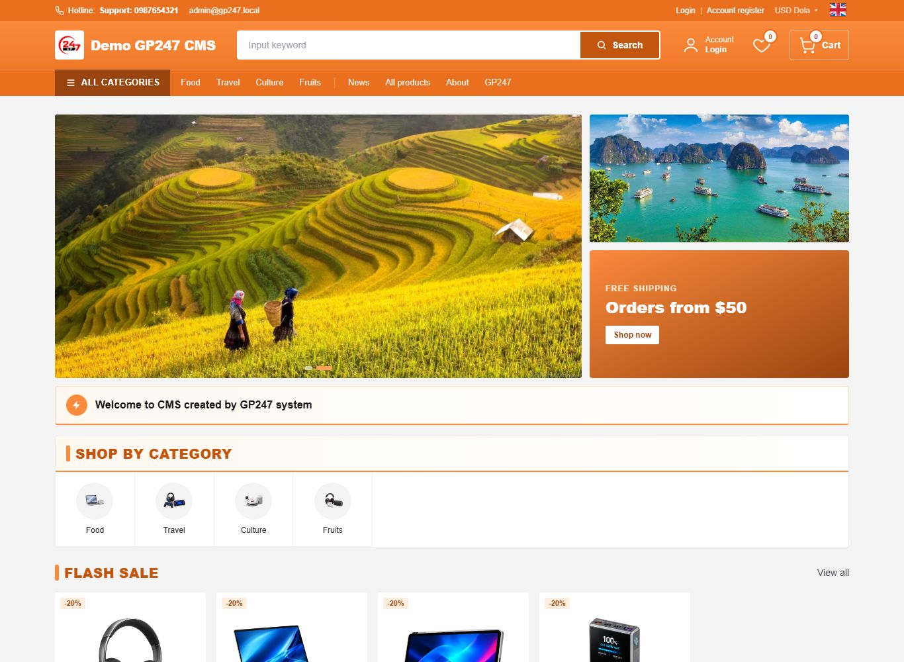
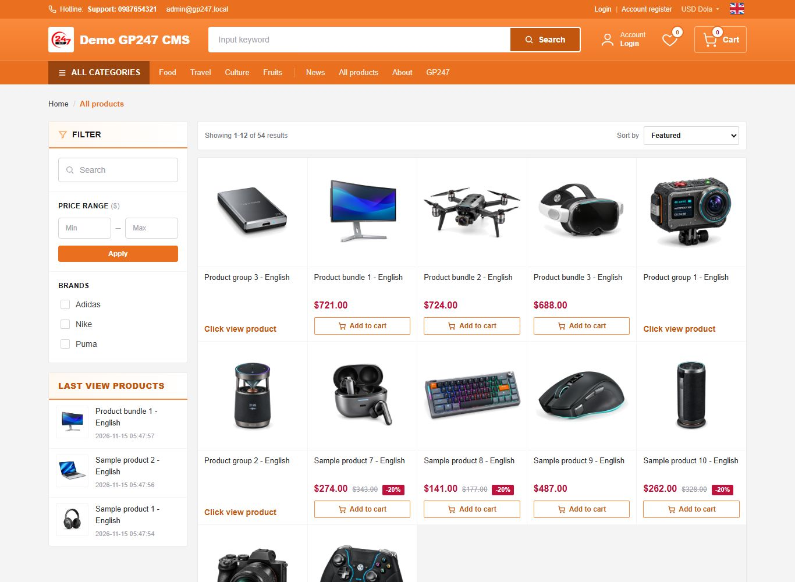
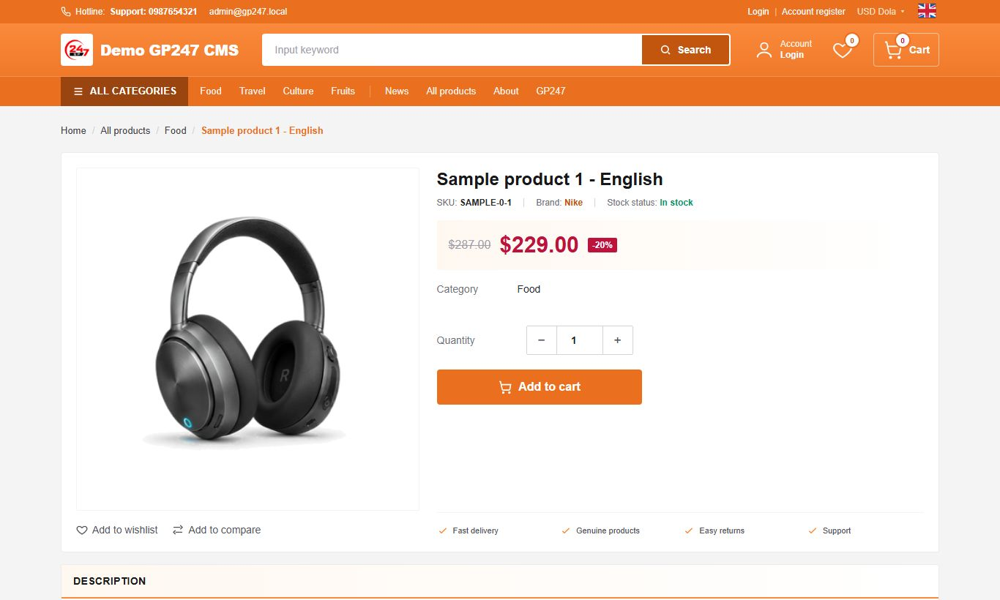
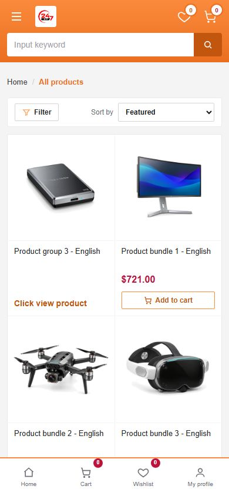

# GP247-EC — Ecommerce storefront template (Tailwind)

**English** · [Tiếng Việt](readme_vi.md) · [日本語](readme_ja.md)

GP247-EC is a **free** storefront template for S-Cart with a **marketplace** look in **orange**:
a three-tier orange header with a wide search box and a category bar, a home page made of dense product shelves,
product cards with discount tags, a filter sidebar on listings, a table-style cart and a numbered checkout stepper.
Behaviour (Livewire, routes, data) is the same as the default `GP247Front` template.
Unlike `GP247Front` (whose views are spread across the `gp247/front` and `gp247/shop` packages), **every file of
GP247-EC lives in one folder**: layout, front pages, shop pages, customer account, login/register, cart, checkout
(Livewire), emails, components, CSS/JS sources and the compiled bundle.

**Live demo:** <https://store.s-cart.org/>



| Item | Value |
|---|---|
| Key (folder, `configKey`) | `GP247EC` |
| Display name | GP247-EC - Ecommerce (Tailwind) |
| Requires | `gp247/core` 3.13+, `gp247/front`, `gp247/shop` |
| License | Free |

## What's new in 1.0.7
- **My data, delete my account** — the account area has **My data**: customers download a copy of their data and delete their account
  (with a waiting time they can call off); while the account waits to be deleted, the account area shows a notice with a call-off button.
  Shoppers without an account ask for a copy or for deletion on the **Your personal data** page (`/privacy-request`). The emails use the
  GP247-EC design. Needs S-Cart 3.12 or later; older versions do not show it.
- **Province and ward picked from a list** — with an address plugin, the registration, account, address book and checkout pages let
  customers type to search and pick their country, province / city and ward / commune. A shop without the shared address block keeps the
  typed fields.

## Screenshots

| Product listing (filter sidebar) | Product detail | Phone |
|---|---|---|
|  |  |  |

## Install and activate

```bash
php artisan gp247:ext-install --type=template --key=GP247EC
php artisan optimize:clear
```

Activate it per store in admin → **System management → Website information**, **Template** field. Switching a
store to GP247-EC seeds its layout blocks (banner, products, categories, promotions, email subscribe) and sample
banners for that store; switching away removes them.

## Home page

The home page is assembled from layout blocks (admin → Layout block). Assigning GP247-EC to a store seeds:

| Block (`blocks/…`) | Position | Content |
|---|---|---|
| `banner_image` | top | Two-thirds slider + two promo tiles |
| `welcome` | bottom | Welcome strip |
| `shop_category_home` | bottom | Category icons |
| `shop_product_promotion` | bottom | Shelf of products on promotion |
| `shop_product_home` | bottom | Newest products, 6-column grid |
| `shop_category_tabs` | bottom | Top picks by category (tabs) |
| `shop_brand_home` | bottom | Featured brands |
| `email_subscribe` | bottom | Newsletter band |

Each block can be disabled, reordered (higher sort shows first) or deleted in admin.

**Hero banners** (admin → **Banner**):

| Area | Source | Notes |
|---|---|---|
| Slider (left) | Banners of type **Banner** | Image or HTML; a URL makes it clickable |
| Top-right tile | **First** banner of type **Banner store** | Ordered by Sort, smallest first |
| Bottom-right tile | **Second** banner of type **Banner store** | Without one, the default "Hot deals" tile links to all products |

On each right-hand tile the image fills the tile and the HTML, if any, is drawn on top; an HTML-only banner gets the
orange gradient. A URL makes the whole tile a tracked link. The right-hand tiles show on wide screens only.

## Folder structure

```
GP247EC/
├── layout.blade.php, layout/      # Page shell, menu, footer
├── screen/                        # Front pages (home, page, search, contact, 404) + shop_* pages
├── account/, auth/                # Customer area, login / register / password reset
├── livewire/, partials/           # Cart, checkout, product card, filter
├── blocks/, common/               # Layout blocks and shared partials
├── gp247_components/              # Breadcrumb, language / currency switcher, meta, notice
├── email/                         # Contact, order and account emails
├── resources/assets/              # CSS / JS sources + tailwind.config.js
├── public/                        # Compiled bundle (css/app.css, js/app.js), images
├── screenshots/                   # Demo images used by this README
└── AppConfig.php, Provider.php, Route.php, function.php, config.php, gp247.json, Lang/
```

## Customizing

Edit the files in this folder directly. The template does **not** receive view fixes from `gp247/front` /
`gp247/shop` updates — when a package changes a matching page, compare and port the change yourself.

## Build CSS

The CSS is **precompiled** Tailwind v3: a class added to a Blade file has no effect until you rebuild.
Run from the site root (where `artisan` lives):

```bash
npx tailwindcss@3 -c app/GP247/Templates/GP247EC/resources/assets/tailwind.config.js -i app/GP247/Templates/GP247EC/resources/assets/css/app.css -o app/GP247/Templates/GP247EC/public/css/app.css --minify
```

```bash
cp app/GP247/Templates/GP247EC/resources/assets/js/app.js app/GP247/Templates/GP247EC/public/js/app.js
```

```bash
php artisan gp247:ext-publish --type=template --key=GP247EC
```

The last command copies the template's `public/` to `public/GP247/Templates/GP247EC/` so browsers get the new build.

## Update safety

- A 1-click update overwrites the whole template folder but keeps the database. Never store user uploads in this folder.
- `config.php` holds defaults only (currently empty).
