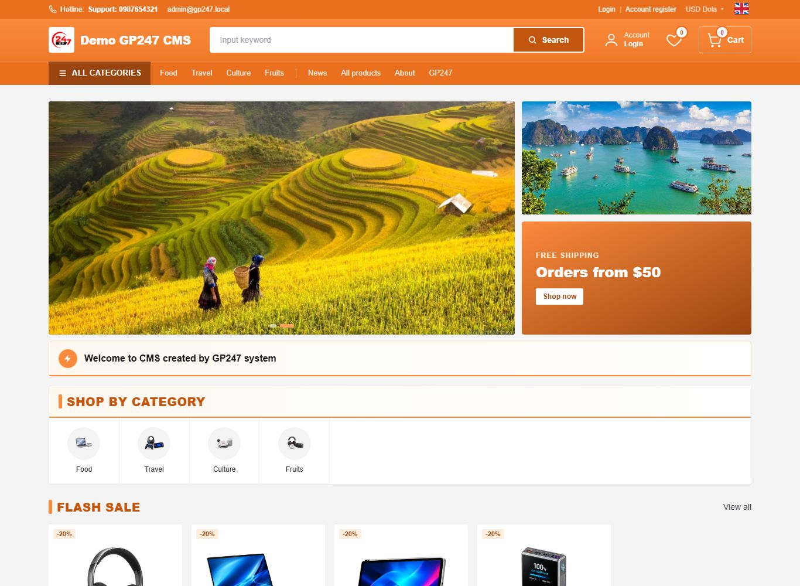
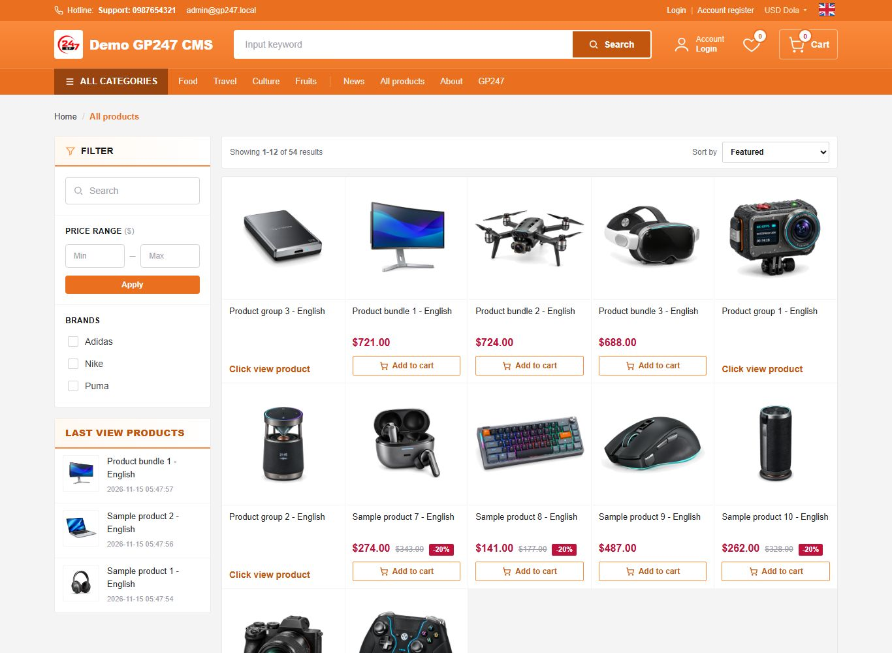
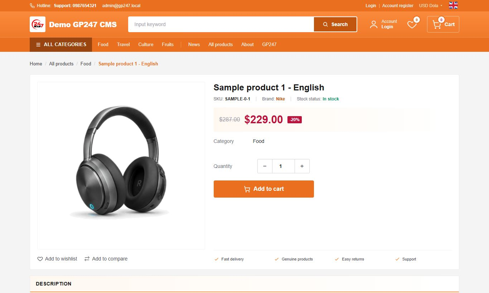
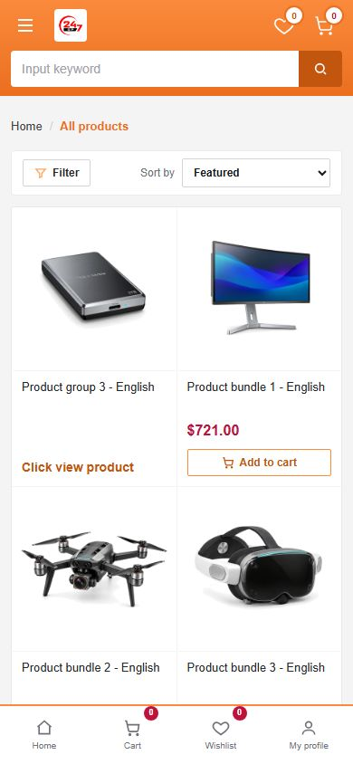

# GP247-EC — EC ストアフロントテンプレート (Tailwind)

[English](readme.md) · [Tiếng Việt](readme_vi.md) · **日本語**

GP247-EC は S-Cart 向けの**無料**ストアフロントテンプレートで、**オレンジ**の**マーケットプレイス**風デザインです：
大きな検索ボックスとカテゴリーバーを備えた 3 段のオレンジのヘッダー、商品棚を並べたトップページ、割引タグ付きの商品カード、
一覧ページ左側の絞り込みサイドバー、表形式のカート、番号付きステップのチェックアウト。
機能（Livewire、ルート、データ）は標準テンプレート `GP247Front` と同じです。
`GP247Front`（ビューが `gp247/front` と `gp247/shop` の 2 つのパッケージに分散）と異なり、**GP247-EC のファイルはすべて
1 つのフォルダにまとまっています**：レイアウト、フロントページ、ショップページ、会員エリア、ログイン／登録、カート、
チェックアウト（Livewire）、メール、コンポーネント、CSS/JS のソースとビルド済みファイル。

**デモ:** <https://store.s-cart.org/>



| 項目 | 値 |
|---|---|
| キー（フォルダ、`configKey`） | `GP247EC` |
| 表示名 | GP247-EC - Ecommerce (Tailwind) |
| 必要条件 | `gp247/core` 3.13 以上、`gp247/front`、`gp247/shop` |
| ライセンス | 無料 |

## スクリーンショット

| 商品一覧（左側の絞り込み） | 商品詳細 | スマートフォン |
|---|---|---|
|  |  |  |

## インストールと有効化

```bash
php artisan gp247:ext-install --type=template --key=GP247EC
php artisan optimize:clear
```

店舗ごとに、管理画面 → **システム管理 → ウェブサイト情報** の **Template** 欄で有効化します。GP247-EC に切り替えると、
その店舗用のレイアウトブロック（バナー、商品、カテゴリ、セール、メール購読）とサンプルバナーが作成され、
別のテンプレートに切り替えると削除されます。

## トップページ

トップページはレイアウトブロック（管理画面 → Layout block）で構成されます。店舗に GP247-EC を割り当てると次のブロックが作成されます：

| ブロック（`blocks/…`） | 位置 | 内容 |
|---|---|---|
| `banner_image` | top | 2/3 幅のスライダー + プロモーション枠 2 つ |
| `welcome` | bottom | ウェルカムバー |
| `shop_category_home` | bottom | カテゴリーアイコン |
| `shop_product_promotion` | bottom | セール中の商品棚 |
| `shop_product_home` | bottom | 新着商品（6 列） |
| `shop_category_tabs` | bottom | カテゴリー別おすすめ（タブ） |
| `shop_brand_home` | bottom | 注目ブランド |
| `email_subscribe` | bottom | メールマガジン登録 |

各ブロックは管理画面で無効化・並べ替え（sort が大きいほど上）・削除できます。

**トップのバナー**（管理画面 → **Banner**）：

| 場所 | 取得元 | 補足 |
|---|---|---|
| 左のスライダー | 種類 **Banner** のバナー | 画像または HTML。URL があればクリック可能 |
| 右上の枠 | 種類 **Banner store** の **1 件目** | Sort の小さい順 |
| 右下の枠 | 種類 **Banner store** の **2 件目** | ない場合は既定の「Hot deals」枠（全商品へのリンク） |

右側の各枠では画像が枠いっぱいに表示され、HTML があればその上に重ねて表示されます。HTML だけのバナーはオレンジの
グラデーション背景になります。URL を設定すると枠全体がリンク（クリック数を計測）になります。右側の枠は広い画面でのみ表示されます。

## フォルダ構成

```
GP247EC/
├── layout.blade.php, layout/      # ページの枠、メニュー、フッター
├── screen/                        # フロントページ（home, page, search, contact, 404）+ shop_* ページ
├── account/, auth/                # 会員エリア、ログイン／登録／パスワード再設定
├── livewire/, partials/           # カート、チェックアウト、商品カード、絞り込み
├── blocks/, common/               # レイアウトブロックと共通パーツ
├── gp247_components/              # パンくず、言語／通貨切替、meta、通知
├── email/                         # お問い合わせ・注文・アカウントのメール
├── resources/assets/              # CSS / JS ソース + tailwind.config.js
├── public/                        # ビルド済み（css/app.css, js/app.js）、画像
├── screenshots/                   # README 用のデモ画像
└── AppConfig.php, Provider.php, Route.php, function.php, config.php, gp247.json, Lang/
```

## カスタマイズ

このフォルダ内のファイルを直接編集します。本テンプレートは `gp247/front` / `gp247/shop` の更新によるビューの修正を
**受け取りません**。パッケージ側で対応するページが変わった場合は、内容を比較して手動で反映してください。

## CSS のビルド

CSS は**事前コンパイル**された Tailwind v3 です。Blade に新しいクラスを追加した場合、再ビルドするまで効きません。
サイトのルート（`artisan` がある場所）で実行します：

```bash
npx tailwindcss@3 -c app/GP247/Templates/GP247EC/resources/assets/tailwind.config.js -i app/GP247/Templates/GP247EC/resources/assets/css/app.css -o app/GP247/Templates/GP247EC/public/css/app.css --minify
```

```bash
cp app/GP247/Templates/GP247EC/resources/assets/js/app.js app/GP247/Templates/GP247EC/public/js/app.js
```

```bash
php artisan gp247:ext-publish --type=template --key=GP247EC
```

最後のコマンドで、テンプレートの `public/` が `public/GP247/Templates/GP247EC/` にコピーされ、ブラウザに新しいビルドが届きます。

## 更新時の安全性

- ワンクリック更新はテンプレートフォルダ全体を上書きしますが、データベースは保持します。ユーザーのアップロードファイルをこのフォルダに保存しないでください。
- `config.php` は既定値のみ（現在は空）です。
