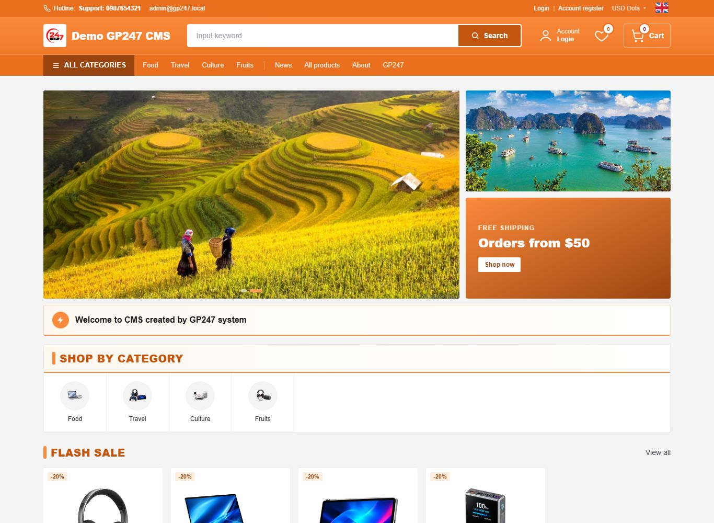
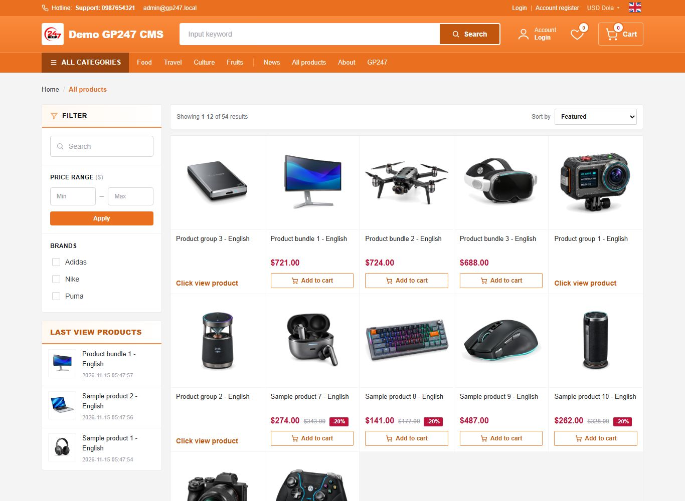
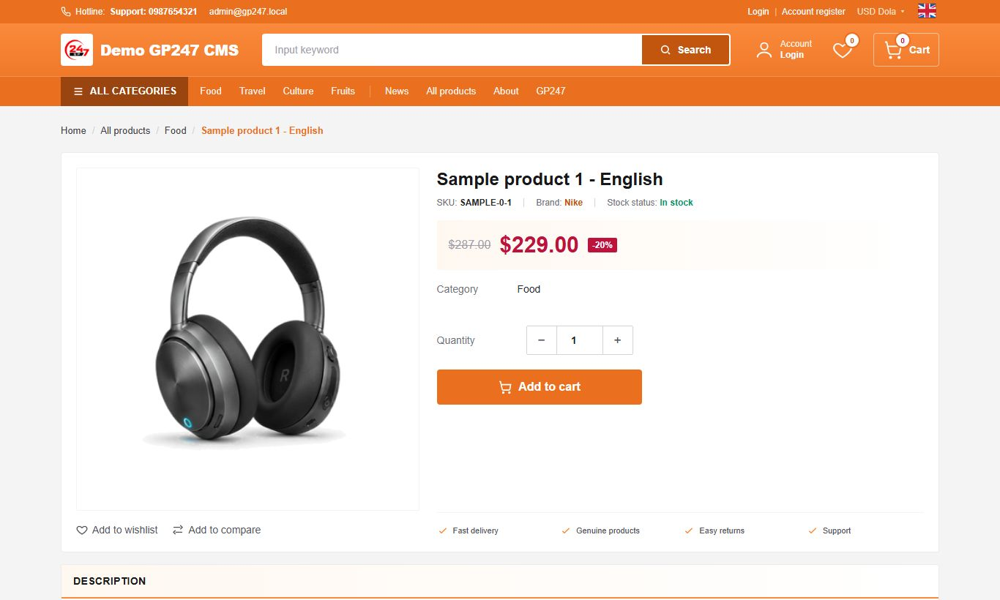
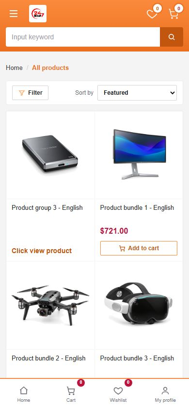

# GP247-EC — Template bán hàng (Tailwind)

[English](readme.md) · **Tiếng Việt** · [日本語](readme_ja.md)

GP247-EC là template storefront **miễn phí** cho S-Cart, giao diện **marketplace** tông **cam**:
header cam 3 tầng với ô tìm kiếm lớn và thanh danh mục, trang chủ dạng các "kệ" sản phẩm dày, thẻ sản phẩm có nhãn
giảm giá, cột bộ lọc bên trái ở trang danh sách, giỏ hàng dạng bảng và thanh toán có thanh tiến trình đánh số.
Phần chức năng (Livewire, route, dữ liệu) giữ nguyên như template mặc định `GP247Front`.
Khác với `GP247Front` (view nằm rải ở hai package `gp247/front` và `gp247/shop`), **mọi file của GP247-EC nằm
tập trung trong một thư mục**: layout, trang front, trang shop, tài khoản khách, đăng nhập/đăng ký, giỏ hàng,
thanh toán (Livewire), email, component, CSS/JS nguồn và bản đã build.

**Xem demo:** <https://store.s-cart.org/>



| Mục | Giá trị |
|---|---|
| Khoá (thư mục, `configKey`) | `GP247EC` |
| Tên hiển thị | GP247-EC - Ecommerce (Tailwind) |
| Yêu cầu | `gp247/core` 3.13+, `gp247/front`, `gp247/shop` |
| Giấy phép | Miễn phí |

## Ảnh demo

| Danh sách sản phẩm (bộ lọc bên trái) | Chi tiết sản phẩm | Điện thoại |
|---|---|---|
|  |  |  |

## Cài đặt và kích hoạt

```bash
php artisan gp247:ext-install --type=template --key=GP247EC
php artisan optimize:clear
```

Kích hoạt cho từng cửa hàng tại admin → **Quản lý hệ thống → Thông tin website**, ô **Template**. Khi đổi sang
GP247-EC, template tạo sẵn các layout block (banner, sản phẩm, danh mục, khuyến mãi, đăng ký email) và banner mẫu
cho cửa hàng đó; khi đổi sang template khác, các block/banner này bị xoá.

## Trang chủ

Trang chủ được ghép từ các layout block (admin → Layout block). Khi gán GP247-EC cho một cửa hàng, template tạo sẵn:

| Block (`blocks/…`) | Vị trí | Nội dung |
|---|---|---|
| `banner_image` | top | Banner trượt 2/3 + 2 ô quảng cáo |
| `welcome` | bottom | Dải chào mừng |
| `shop_category_home` | bottom | Danh mục dạng icon |
| `shop_product_promotion` | bottom | Kệ sản phẩm đang khuyến mãi |
| `shop_product_home` | bottom | Sản phẩm mới, lưới 6 cột |
| `shop_category_tabs` | bottom | Gợi ý theo danh mục (tab) |
| `shop_brand_home` | bottom | Thương hiệu nổi bật |
| `email_subscribe` | bottom | Đăng ký nhận tin |

Có thể tắt, đổi thứ tự (sort lớn đứng trên) hoặc xoá từng block trong admin.

**Banner đầu trang** (admin → **Banner**):

| Vùng | Lấy từ | Ghi chú |
|---|---|---|
| Banner trượt bên trái | Các banner loại **Banner** | Ảnh hoặc HTML, có link thì bấm được |
| Ô phải phía trên | Banner **thứ nhất** loại **Banner store** | Thứ tự theo trường Sort, nhỏ trước |
| Ô phải phía dưới | Banner **thứ hai** loại **Banner store** | Chưa có thì hiện ô "Hot deals" mặc định, dẫn tới tất cả sản phẩm |

Mỗi ô bên phải: ảnh phủ kín ô, nội dung HTML (nếu có) hiện đè lên trên; banner chỉ có HTML thì nền là dải cam.
Có link thì cả ô bấm được (có đếm lượt bấm). Hai ô bên phải chỉ hiện trên màn hình rộng.

## Cấu trúc thư mục

```
GP247EC/
├── layout.blade.php, layout/      # Khung trang, menu, chân trang
├── screen/                        # Trang front (home, page, search, contact, 404) + trang shop_*
├── account/, auth/                # Khu vực khách hàng, đăng nhập / đăng ký / quên mật khẩu
├── livewire/, partials/           # Giỏ hàng, thanh toán, thẻ sản phẩm, bộ lọc
├── blocks/, common/               # Layout block và partial dùng chung
├── gp247_components/              # Breadcrumb, đổi ngôn ngữ / tiền tệ, meta, thông báo
├── email/                         # Email liên hệ, đơn hàng, tài khoản
├── resources/assets/              # Nguồn CSS / JS / tailwind.config.js
├── public/                        # Bản build (css/app.css, js/app.js), ảnh
├── screenshots/                   # Ảnh demo dùng trong README
└── AppConfig.php, Provider.php, Route.php, function.php, config.php, gp247.json, Lang/
```

## Sửa giao diện

Sửa trực tiếp file trong thư mục này. Template **không** nhận bản sửa view từ các bản cập nhật của
`gp247/front` / `gp247/shop` — nếu package sửa một trang tương ứng, cần tự đối chiếu và chép sang.

## Build CSS

CSS là Tailwind v3 **biên dịch sẵn**: thêm class mới vào Blade thì phải build lại, nếu không class không có hiệu lực.
Chạy từ thư mục gốc site (nơi có `artisan`):

```bash
npx tailwindcss@3 -c app/GP247/Templates/GP247EC/resources/assets/tailwind.config.js -i app/GP247/Templates/GP247EC/resources/assets/css/app.css -o app/GP247/Templates/GP247EC/public/css/app.css --minify
```

```bash
cp app/GP247/Templates/GP247EC/resources/assets/js/app.js app/GP247/Templates/GP247EC/public/js/app.js
```

```bash
php artisan gp247:ext-publish --type=template --key=GP247EC
```

Lệnh cuối chép `public/` của template ra `public/GP247/Templates/GP247EC/` để trình duyệt nhận bản mới.

## An toàn khi cập nhật

- Cập nhật 1-click ghi đè toàn bộ thư mục template nhưng giữ dữ liệu DB. Không lưu file người dùng tải lên trong thư mục này.
- `config.php` chỉ chứa giá trị mặc định (hiện để trống).
